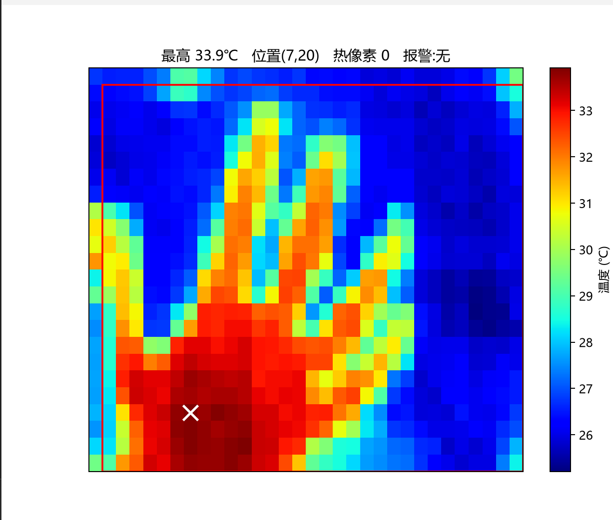
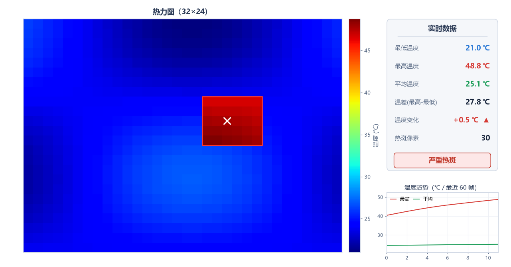
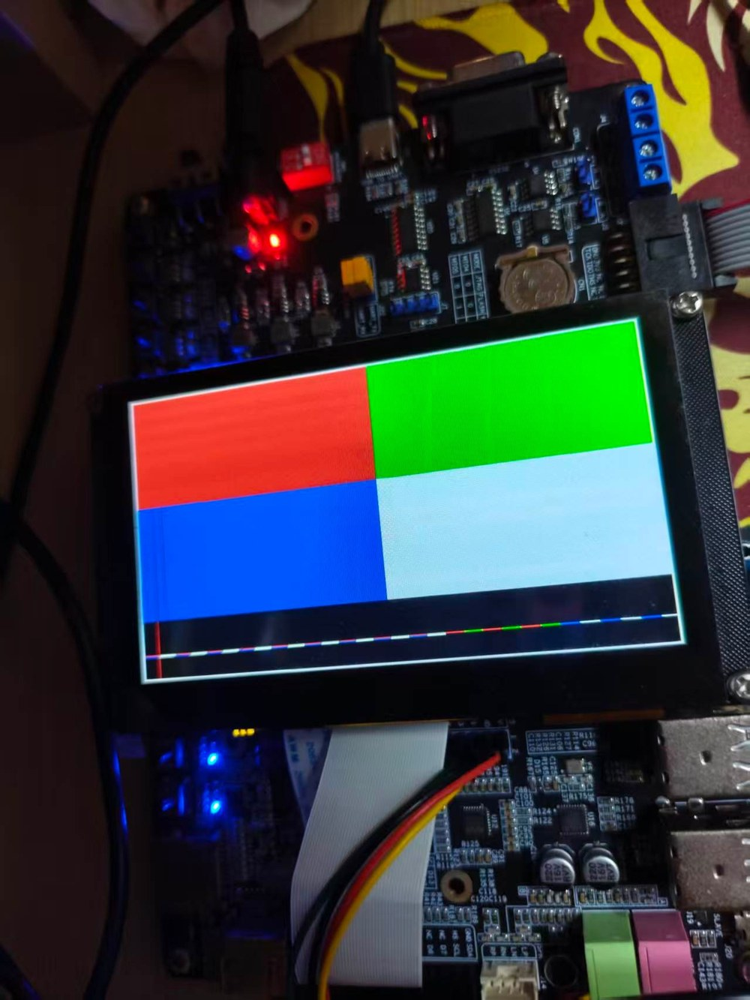
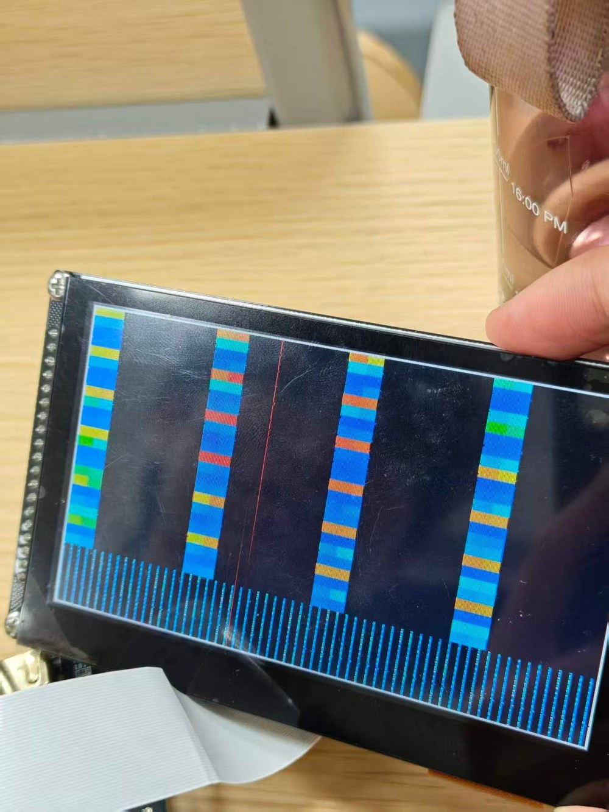

# MLX90640 红外热成像与热斑监测系统

> 基于 Xilinx ZYNQ-7010 的红外热成像系统：MLX90640 采集 → PS 温度解算 → PL 驱动 4.3 寸 RGB 屏显示 → 声光报警


---

## 项目简介

本系统面向**光伏组件热斑检测**、配电柜过热预警、电子器件热设计等场景，在单片 ZYNQ-7010 上完成
「红外采集 → 温度补偿解算 → 热斑识别 → 伪彩色显示 → 声光报警」的完整闭环，**不依赖上位机即可独立工作**。

| 特性 | 说明 |
|---|---|
| 红外分辨率 | 32 × 24（MLX90640，55°×35° FOV） |
| 显示 | 4.3 寸 480×272 RGB 屏，54Hz 刷新，RGB565 |
| 热斑判据 | 高于整幅温度中位数 10℃，环境自适应 |
| 报警 | 两级声光（短鸣 / 长鸣），PL 硬件产生 3.05kHz 方波 |
| 信息区 | 自研 3×5 点阵字体，显示 MAX/MIN/AVG/AREA + 报警等级 |
| 显存 | PL 内部 16K×16 双端口 RAM，无外扩、不占 DDR |

---

## 系统架构

```
┌──────────────────── ZYNQ-7010 (XC7Z010) ────────────────────┐
│  PS (Cortex-A9 @667MHz)                PL (@50MHz)          │
│  ├─ I2C0(EMIO) → MLX90640 采集          ├─ lcd_rgb.v   时序  │
│  ├─ 温度补偿 / 热斑判定 / 报警分级       ├─ fb_store.v  显存  │
│  └─ EMIO GPIO 32 位并行显存协议 ──────► └─ buzzer_tone.v 方波 │
└──────────┬───────────────────┬───────────────────┬─────────┘
       29 根 RGB 信号        蜂鸣器             2 根 I2C
      ┌────▼─────┐      ┌─────▼────┐      ┌─────▼──────┐
      │ 4.3" LCD │      │  蜂鸣器   │      │ MLX90640   │
      └──────────┘      └──────────┘      └────────────┘
```

### 关键引脚映射（4.3 寸屏，已实测验证）

| 信号 | 球号 | 信号 | 球号 | 信号 | 球号 |
|---|---|---|---|---|---|
| R3~R7 | U12 U13 V13 T14 T15 | G2~G7 | T16 U17 P15 P16 P14 R14 | B3~B7 | W19 U18 U19 R16 R17 |
| R0 | T11 | G0 G1 | V17 V18 | B0~B2 | V16 W16 W18 |
| PCLK | W15 | HSYNC | V12 | VSYNC | W13 |
| DE | V15 | BL | T19 | — | — |

> **I2C 复用**：SDA = **T10（LCD_R1）**，SCL = **T12（LCD_R2）**。
> 显示采用 RGB565，红色只用 R7~R3，R1/R2 不参与成像，因此可与 I2C 共用。

---

## 目录结构

```
.
├── code/
│   ├── vivado/                  PL 端（Vivado 2023.2）
│   │   ├── rtl/                 lcd_rgb.v · fb_store.v · buzzer_tone.v · i2c_emio.v
│   │   ├── constrs/             lcd_pins.xdc（29 引脚）· mlx90640.xdc（I2C/蜂鸣器）
│   │   ├── bd/                  design_1.bd（Block Design）
│   │   └── scripts/             加载脚本 run_ocm.tcl / run_demo.tcl
│   ├── vitis/                   PS 端（Vitis 2023.2，裸机）
│   │   └── src/                 main.c · mlx90640_api.c · mlx90640_i2c.c · lscript.ld
│   └── host/                    PC 上位机 viewer.py（matplotlib 实时热力图）
├── hardware/
│   └── 3d-model/                FPGA 外壳 STL（顶壳/底壳）+ 打印生产单 + 装配说明
├── docs/                        技术文档（docx/pdf）+ 底板原理图
└── images/                      实测照片
```

---

## 快速上手

### 1. 环境要求

- Vivado / Vitis **2023.2**
- 野火 ZYNQ-7010 开发板（核心板 + BTB 底板）
- MLX90640 模块（**VCC 接 5V**，模块自带 3.3V 稳压）
- 4.3 寸 480×272 RGB 屏

### 2. 硬件连接

```
MLX90640  VCC → 5V
          GND → GND
          SDA → LCD_R1  (FPGA T10)
          SCL → LCD_R2  (FPGA T12)
屏        通过 FPC 排线插入底板 LCD 座
蜂鸣器     → U14
```

> ⚠️ **务必断电接线**。热插拔 5V 供电的 I2C 模块很容易打坏传感器 I/O。
> 建议在 SDA/SCL 上各加 4.7kΩ 上拉电阻。

### 3. 编译

```bash
# PL 端：Vivado 打开 code/vivado 下重建工程，或直接使用现有比特流
vivado -mode batch -source build.tcl

# PS 端：Vitis 编译（或命令行）
cd code/vitis/build && make -j4
```

### 4. 烧写运行

```bash
# 一键加载（比特流 + ps7_init + ELF + 使能 PL 时钟）
xsct code/vivado/scripts/run_ocm.tcl
```

> **关键**：`ps7_init` 会把 FCLK0 的时钟使能位清零，加载脚本必须补一句：
> ```tcl
> mwr 0xF8000100 [expr {[mrd -value 0xF8000100] | 0x1}]
> ```
> 否则 PL 没有时钟，屏幕全黑。

---

## 上位机

```bash
pip install pyserial matplotlib numpy
python code/host/viewer.py
```

自动识别串口，实时显示热力图、温度统计与报警状态。

---

## 实测指标

| 项目 | 结果 |
|---|---|
| 测温重复性 | σ ≤ 0.3℃（同一目标连续 30 帧） |
| 热斑定位 | 1 个传感器像素 |
| 报警响应 | < 2s |
| 显示刷新 | 54Hz（PL 硬件时序，无撕裂） |
| 整机功耗 | < 2.5W |

---

## 已知问题与改进方向

| 问题 | 现状 | 改进 |
|---|---|---|
| I2C 仅 20kHz | 读一帧 750ms，画面约 1 帧/秒 | 加 4.7kΩ 上拉后可跑 400kHz，画面约 10 帧/秒 |
| Xilinx I2C 驱动无超时 | 传感器不应答会导致程序卡死 | 自研带超时的位操作 I2C |
| 传感器模块易损 | 热插拔后 I/O 击穿 | 断电接线 + ESD 防护 |

详细的问题分析见 `docs/MLX90640热成像系统技术文档.pdf` 第 3.5 节（6 个工程问题的现象/根因/解决）。

---

## 致谢

- Melexis 官方 MLX90640 数据手册与驱动算法
- 野火 ZYNQ-7010 开发资料与底板原理图
- Xilinx Vivado / Vitis 工具链

## License

MIT License — 见 [LICENSE](LICENSE)

---

## 实物照片

**人手红外热图（系统实测输出）**



**PC 端上位机界面**



| LCD 四象限测试（验证引脚映射与显存地址） | 地址映射调试过程 |
|---|---|
|  |  |

> 四象限测试中，四个色块的位置、颜色与预期完全一致，证明 29 根引脚的映射表与
> 480×272 时序参数正确；右图为显存地址映射错误时的条纹现象，据此定位出
> PS 写脉冲与 PL 采样的时序竞争问题。